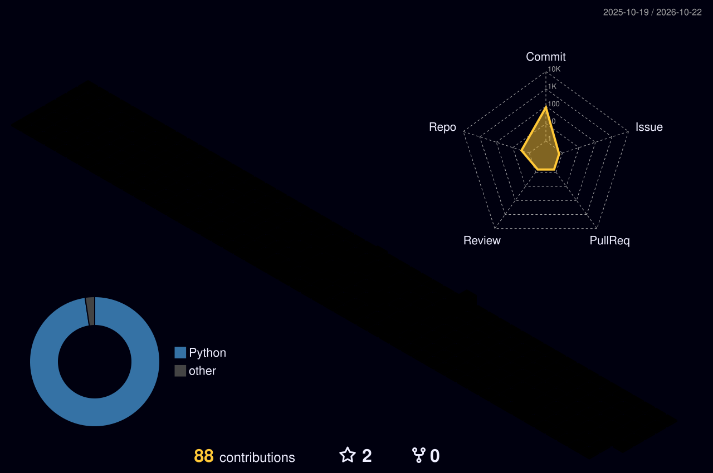

  

  

 

<!-- Custom CSS Bento Grid (custom-css-card.svg) -->

  

 

### Stack

  

    
  

  

    
    
    
    
    
    
    
    
  

 

### Activity

  

 

  

 

### Metrics

  

  
  
  

  <img src="
